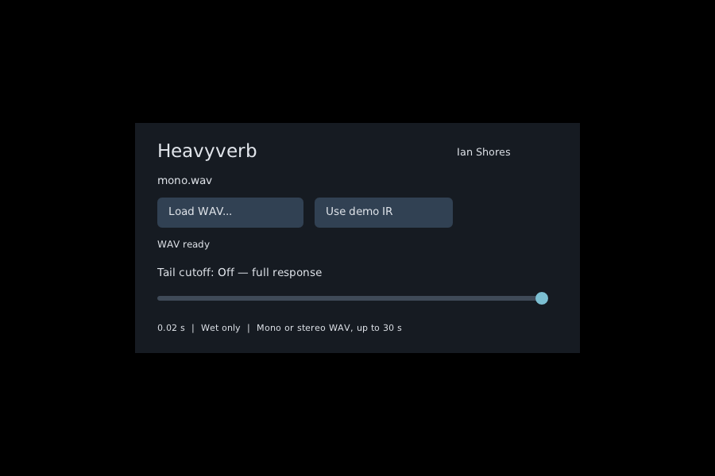

# WAV selector: implementation and validation

Verified on Odysseus, Linux x86_64, Intel Core Ultra 9 185H, 2026-10-23.
[Exact build versions and artifact hashes](artifacts.json).

## Result

HeavyVerbDemo lists **Ian Shores** as its developer. The CLAP and VST3 builds
have an editor with **Load WAV…**, **Use demo IR**, response duration, loading
status, and the existing tail-cutoff control. The original plugin identifiers
and cutoff parameter index are preserved for existing projects.



WAVs are decoded and resampled on a background thread. The loader constructs
the actual generated Pd graph with independent left/right IR channels. Audio
continues through the old graph while loading, primes 256 samples of latency
in the replacement, then crossfades over 50ms. Old graphs are destroyed by the
worker. The file path is saved in plugin state; the audio file stays external.

## Issues found and fixed

| Issue | Fix |
|---|---|
| hvcc's default developer appeared in REAPER | Explicit maker metadata and host author: Ian Shores. |
| CLAP's DPF state-file request hook was unimplemented | Use DPF's file-browser callback and save its selected path. |
| Heavy allocated its first control-message node during playback | Prime that message and graph on the construction thread. |
| A replacement graph initially output its empty latency buffer | Keep the old graph at full level while the replacement fills its buffer. |
| A previous load could overwrite a newer request's status | Update request generation and status together atomically. |
| Heavy's generated queue misaligned 64-bit message structures | Align message slots and payload boundaries to eight bytes during export; retain original notices. |

## Checks

| Check | Result |
|---|---|
| Actual built CLAP: maker, parameter automation, and cutoff restore | Pass; full-quality restoration error 0 in the fixture. |
| Mono duplication and stereo channel/gain assignment | Pass; compared rendered samples with fixture IRs. |
| Project save/load into a new instance; bad-file fallback; rapid selection | Pass. |
| Host sample-rate changes 48→96→48kHz | Pass; saved file reloaded, duration preserved, exact 48kHz fixture restored. |
| PCM16/24/32 and float32/64; 44.1/96→48kHz resampling | Pass; centered impulse integral preserved within 0.001. |
| Reject malformed, nonfinite, wrong-format, multichannel and overlong files | Pass. |
| Worker handoff with variable/in-place callbacks | Pass; zero audio-thread C/C++ allocations in the instrumented runtime. |
| Switch between opposite-polarity impulse responses | Pass; maximum sample step 0.0000416785 with a constant 0.1 input. |
| AddressSanitizer and UndefinedBehaviorSanitizer | Pass for the loader, full generated graph/runtime, and queue test; fail-on-error enabled. |
| Queue boundaries, arbitrary payload sizes, wrap, full, reset | Pass across 100,000 iterations. |
| Hidden X11 editor: click Load WAV, select mono.wav, render and save it | Pass; no interaction with the user's REAPER instance. |
| Export regression: 15 stereo renders and nine cutoff/restore renders | Pass; baseline maximum error 7.73e-9. |
| Native Pd external regression | Pass; recorded full-quality/cutoff tests. |

Raw results: [plugin and sanitizers](plugin-and-sanitizers.log),
[file picker](file-picker.log), [export](export.log), [Pd](pd.log).
The automated Linux workflow builds both formats and runs the headless plugin tests.

## Reproduce

```sh
.venv/bin/python tools/build_plugins.py examples/effect.pd build/effect --dpf /path/to/DPF
python3 tools/test_wav_selector.py build/effect --dpf /path/to/DPF
python3 tools/test_wav_selector.py build/effect --dpf /path/to/DPF --sanitize
```

The optional `clap_ir` test's `--ui` argument opens the editor. GUI validation
used an isolated Xvfb display, software OpenGL and DPF's X11 file-browser
fallback. The desktop portal picker was not exercised. Setting
`HEAVYVERB_UI_EXPECT_PATH` additionally verifies the chosen mono fixture's
saved path and rendered samples after the GUI loop.

## Limits

This remains a wet-only stereo effect with 256 samples of unreported latency.
Switching temporarily runs two graphs; the old tail ends at the crossfade.
Wait for **WAV ready** before saving. A fresh instance with a missing saved WAV
keeps the synthetic demo response and reports a load error. No IR-library files
are bundled or approved by this change.

The VST3 artifact builds successfully; host-level loading/state/UI tests here
exercise CLAP. REAPER was left running untouched. Unreal and Wwise integration
is outside this update. The convolution/FFT algorithm has not changed, so this
report makes no new CPU-performance claim. DPF emits existing file-browser
path-formatting warnings during compilation; the tested paths load correctly.
